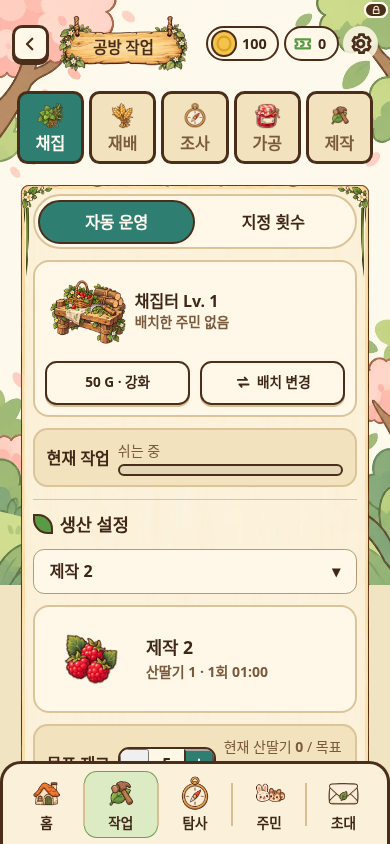
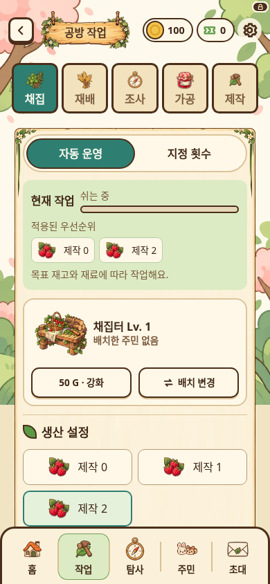
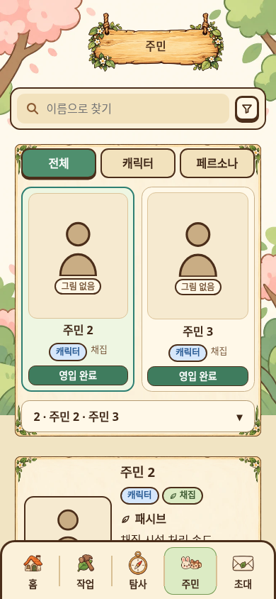
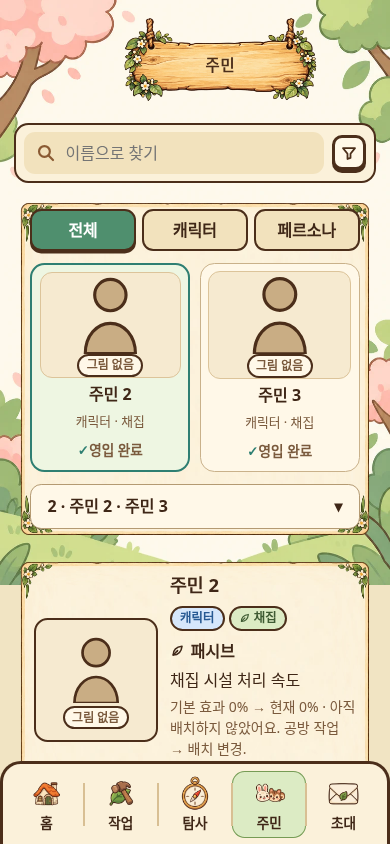
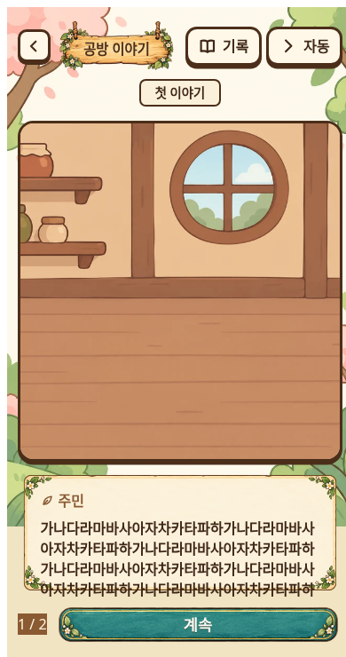
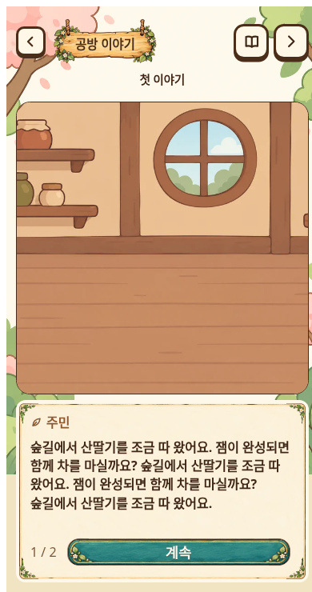

# 화면 구성 보완 — 0.6.21

공개 게임 화면과 비교한 6개 항목을 기준으로 PR #22 병합본(main 6c6bf65)의 화면 구성을 보완했습니다. 원래 목업의 종이·목재·청록 버튼·아이템 그림을 유지하고 정보 순서와 강조를 조정했습니다. 새 이미지 제작은 필요하지 않았습니다.

| 비교 항목 | 반영 |
| --- | --- |
| 홈 | 보조 이야기/누적시간 카드의 테두리와 화살표 강조 완화 |
| 생산 | 현재 작업과 적용 우선순위·대기열을 시설 강화/배치보다 먼저 표시 |
| 제작 목록 | 선택기를 열어야 보이던 운영 물품을 아이템 그림 버튼으로 직접 선택 |
| 주민 목록 | 2열 유지, 그림 비율 4:5 → 4:3, 종류·분야를 한 줄 설명으로 정리, 영입 완료의 버튼 모양 제거 |
| 주민 상세 | 원래 설정을 읽는 영역의 중첩 테두리 제거. 편집 영역의 입력·저장 기능은 유지 |
| 이야기 | 대사·페이지·계속 버튼을 같은 종이 패널로 묶고 상단 기록/자동 도구를 44px 아이콘으로 정리 |

생산 요약은 서버에서 받은 적용 규칙만 사용하고 우선순위대로 정렬합니다. 꺼진 규칙을 제외하며 저장 전 초안으로 현재 생산 상태를 덮어쓰지 않습니다. 조건에 따라 실제 선택되는 작업이 다르므로 '다음 확정 작업'으로 표시하지 않습니다. 생산·보상·기억·저장 스키마·권한·API 계약 변경은 없습니다. 서버 소스 변경은 PACKAGE_VERSION을 빌드 버전과 맞추는 것뿐입니다.

## 전후 화면

390px 너비 검수 화면. 주민은 업로드 없는 상태입니다. 이야기 수정 전은 긴 반복문, 수정 후는 자연스러운 문장 반복을 사용했으므로 문구 자체의 차이는 레이아웃 성능 비교 대상이 아닙니다.

| 화면 | 수정 전 | 수정 후 |
| --- | --- | --- |
| 작업 |  |  |
| 주민 |  |  |
| 이야기 |  |  |

## 검증

- 0.6.21 빌드, 서버 81/클라이언트 67개 strict 타입검사.
- 전체 `npm run test:forest-workshop` 통과. PACKAGE_VERSION 불일치를 발견해 0.6.21로 맞춘 후 전체 재실행 통과.
- 브라우저: 작업, 주민/관계, 이야기, 실측 페이지 분할, 자동 읽기, 프로필.
- 생산 그림 선택의 aria-pressed/선택 변경, 현재 작업의 그림·카운트다운, 적용 규칙과 초안 분리, 적용 순서/꺼짐 제외 확인.
- 이야기 390px/16px와 320px/22px에서 실제 글줄 Range가 대사 패널 안에 들어가고, 분할 페이지를 합치면 원문이 보존됨을 확인. 선택지/질문 전환·최종 보관·기록도 확인.
- Prettier/ESLint, 카탈로그 레인·로케일·카탈로그/해시·릴리스노트 검사 통과.

실제 Android 및 사용자 서버에서의 설치·업데이트·재시작·오프라인·삭제 수명주기는 실행하지 않았습니다. 실제 AI 장문과 사용자 업로드 주민 그림 검증도 남아 있습니다. 추가 주민 에셋이나 다른 게임의 이미지는 패키지에 포함하지 않았습니다.
