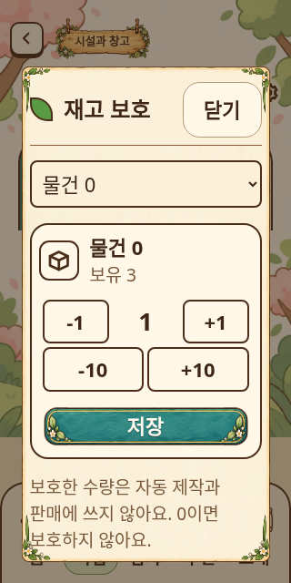
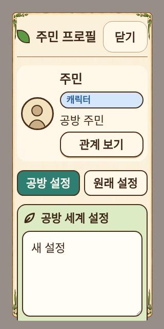
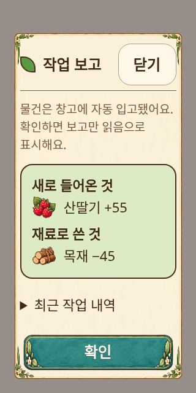

# 상세 화면 보완 — 0.6.20

320×640 화면과 16px·22px 글자로 상세 화면을 재검수하고 보완했습니다. 기존 종이·주요 버튼·아이템 에셋을 유지하며 배치와 정보 우선순위를 조정했습니다. 이 범위에는 새 이미지 제작이 필요하지 않았습니다.

## 변경

- 주민 프로필: 변경 이력 탭·페이지 상태·해당 알림 문구 제거. 공방 설정/원래 설정 두 탭만 남기고 오래된 세 번째 탭 상태는 공방 설정으로 복귀. 초상 64px, 이름·상태·관계 보기 공간 확보.
- 공통 sheetDialog: 기존 닫기 버튼의 핸들러와 비활성 상태를 그대로 사용하여 상단 제목 옆으로 이동. 프로필 헤더도 같은 고정 위치·44px 버튼 기준 사용. 본문은 세로로 스크롤하며 글자나 문장을 생략하지 않음.
- 재고 보호: 품목/보유량, 기본 증감, 10개 단위 증감, 저장 순서. 각 버튼 최소 44px. 수량 초안과 품목별 저장 유지.
- AI 지침: 편집란을 우선하고 상세 적용 설명은 접기. 저장 버전 표시 제거. 저장/초기화 및 빈 지침 검증 유지.
- 기억: 공통 게임형 선택기로 상태/주민 필터 교체. 기억 내용과 인지 주민을 중심으로 표시. 정정 초안과 인지 범위 규칙 유지.
- 작업 보고: 최근 작업 내역은 기본 접힘. 자동 입고 요약과 확인 동작을 먼저 제공하며 내역은 모두 펼쳐서 확인 가능. 확인은 읽음 표시만 수행.
- 주민 그림: 긴 대상 이름, 미리보기 높이, 슬라이더와 보조 버튼 배치 보정. 업로드 규격은 접기. 파일 교체와 배치 적용은 기존처럼 별도 동작.

변경 이력 제거는 사용자 화면에 적용했습니다. 기존 저장 데이터의 주민 기록이나 그림 복원 데이터는 삭제하지 않았습니다. 서버 스키마·권한·API 계약 변경은 없습니다.

## 검증

- 패키지 0.6.20 빌드, 81개 서버/67개 클라이언트 strict 타입검사.
- 전체 `npm run test:forest-workshop` 통과.
- 브라우저: 프로필·창고·기억·지침·우편·작업·초대·작업보고/배정·시작꾸러미.
- 프로필 초안 유지, 제거된 탭 접근 시 복귀, 스크롤 후 닫기 위치 검증.
- 재고 보호 320px/22px에서 버튼의 실제 텍스트 Range가 한 줄인지 및 44px 크기 확인. +1→품목 전환→재렌더→저장, +10→저장 값 확인.
- 기억 필터·정정/사용중지, 작업 내역 펼침과 확인 reportId 확인.
- Prettier/ESLint와 카탈로그 레인·로케일·아카이브 해시·릴리스노트 검사.

브라우저 화면은 실제 소스/에셋과 합성 데이터로 확인했습니다. 실제 사용자 서버 설치/업데이트, Android 실기기, 실제 주민 그림 업로드·AI 장문 출력은 미검증입니다. 긴 편집 화면은 세로 스크롤을 유지합니다.

## 화면 증거

320px 너비, 22px 글자. 주민 그림 대신 업로드 없는 상태를 사용했습니다.

