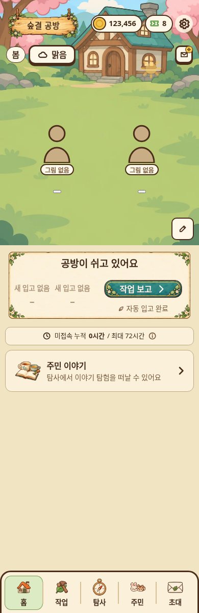
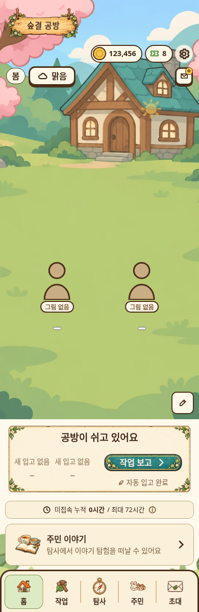
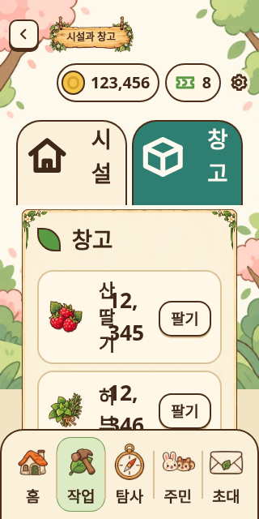
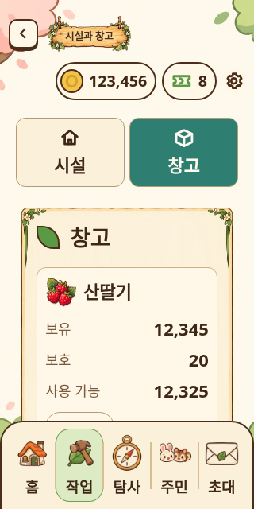
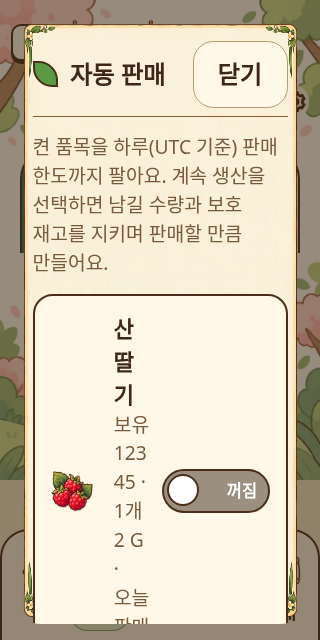
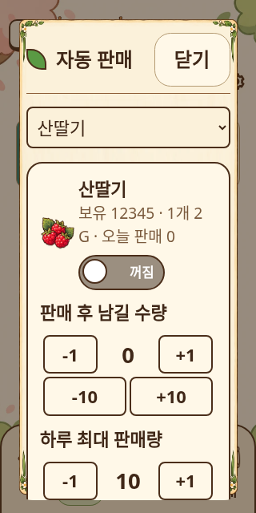
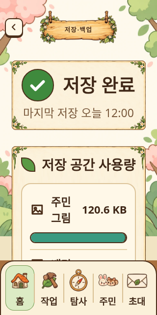
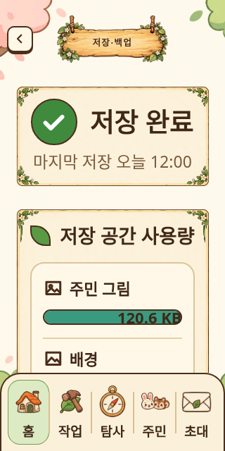

# 전반 UI 재검수 — 0.6.22

## 사용자 제보와 수정

| 제보 | 재현·원인 | 수정 |
| --- | --- | --- |
| 배경 아래가 비어 보임 | `.scroll`의 배경을 `100% auto`로 한 번만 그림. 긴 화면에서 이미지 높이 아래가 단색으로 남음 | 배경을 뷰포트인 `.shell`로 옮기고 `cover` 적용. 본문은 투명하게 스크롤 |
| 홈 전체화면 하단 여백 | 고정 상한이 있는 홈 장면과 높이 자동 column이 남은 높이를 배분하지 못함. 390×1200에서 341.5px, 1280×800에서 37.5px 재현 | column 높이를 호스트에 맞추고 장면이 남은 공간을 채움. 짧은 화면에서는 최소 장면과 본문이 세로로 스크롤. 두 전체화면 여백 0px |
| 창고·상세 구성 | 창고 품목/수량과 자동 판매의 이름·상태가 좁은 행에서 한 글자씩 꺾임 | 품목 그림·이름 + 보유/보호/사용 가능 수량을 행으로 배치. 예약 수량의 미구현 빈 열 제거. 자동 판매는 품목 선택 후 설정하며 초안은 같은 DOM에서 유지 |
| 주요 기능 외 전반 검수 | 연결 점검 포함 14개 경로와 상세·보조·로딩·오류 상태를 목록화 | 72개 상태 × 5가지 화면 조건 + 실제 전체화면 2회 + 전체화면 안에서 크기 변경 1회 = 363개 측정. 창고·탭·사용량·등록 자료·우선순위·자동 판매·페어 선택의 폭과 여백 보정 |

전체화면 호스트는 `border-box`로 안전 영역을 계산하고 하단 안전 영역을 내비게이션에서 한 번만 확보합니다. 실제 노치가 있는 기기는 별도 검증이 필요합니다.

## 화면 범위

| 경로 | 검수한 상태 / 기능 |
| --- | --- |
| 세계 목록 | 초기 생성, 로딩·오류, 복원 접기. 기존 브라우저 테스트로 세계 페이지 전환·생성 초안 확인 |
| 홈 | 기본, 시작 꾸러미, 작업 보고, 지면 편집, 우편·긴 편지, 납품, AI 지침·기억 |
| 공방 작업 | 자동 운영·지정 횟수, 시설·제작 그림·우선순위·재료 대기. 적용 규칙과 초안 구분 |
| 시설·창고 | 시설 해금 전/후, 재고 보호 목록/편집, 창고, 수동 판매, 자동 판매 |
| 설정 | 내 공방·표시·관리, 계절·날씨·글자·자동 읽기·모델 연결 선택 |
| 저장·백업 | 사용량, 내보내기/불러오기, 복원 미리보기, 그림 이력 정리 |
| 주민 | 목록/상세, 전문 분야, 프로필 공방 설정·원래 설정 |
| 관계 | 기본 페어 목록, 추가 후보·이미 연결된 후보, 기억·지침 열기 |
| 주민 등록 | 자료 선택·공방 설정·시작 주민, 자료 로딩·오류, 초안 유지 |
| 주민 그림 | 미등록 상태·배치 조절, 이전 그림 빈 상태. 실제 업로드는 미검증 |
| 초대 | 기본·종표 교환, 희망 주민·확률·기록·결과·납품 |
| 탐사 | 이야기·조사·순찰, 기존 탐사 브라우저 테스트의 준비·기록·동작 |
| 이야기 | 본문·선택지·기록·완료, 실측 분할·원문 보존·자동 읽기. 긴 글과 확대 글자 검증 |
| 연결 점검 | 테스트 호스트 기능이 없는 환경의 로딩/오류 UI. 실제 연결·모델 호출 검증 아님 |

각 경로의 해당 데이터 로딩/오류 UI도 별도로 렌더링했습니다. 이는 가능한 모든 저장 데이터 조합·게임 진행 단계·장치 환경을 완전 검증했다는 뜻은 아닙니다.

## 공통 보완

- 시설/창고 탭의 아이콘과 글자가 세로로 쪼개지지 않게 정렬.
- 공통 메뉴의 중첩 여백을 줄이고 그림·제목·우측 이동 표시를 그리드로 배치. 등록의 선택 자료 행도 보정.
- 저장 공간의 이름·용량·막대를 각각 읽을 수 있는 행에 배치.
- 우선순위의 물품명·목표·켜짐·순서 조작, 자동 판매 진입 행, 페어 추가 후보의 이름·종류·상태를 보정.
- 판매·페어 추가·이전 그림·그림 이력 정리도 공통 상세 창 헤더를 사용해 닫기를 상단에서 제공.
- 초대 부족 안내와 준비 중 표시가 버튼 밖으로 넘치지 않도록 배치.
- 자동 판매의 긴 규칙 설명은 펼침 안내로 제공하며 설정 조작을 먼저 노출.

생산·판매·보호 계산·재화·저장 스키마·API·권한은 변경하지 않았습니다. 서버 소스 변경은 패키지 버전 상수뿐입니다. 기존 계절·종이·버튼·아이템 에셋을 사용했으며 새 그림 제작은 필요하지 않았습니다.

## 실제 캡처 비교

동일 합성 데이터와 최신 검수 도구로 46aaf80의 소스와 수정 소스를 별도 번들링해 비교했습니다. 이전 소스는 새로운 검수 기준에서 실패하는 재현용이며, 통과한 것으로 취급하지 않았습니다.

| 항목 | 수정 전 | 수정 후 |
| --- | --- | --- |
| 홈 전체화면 390×1200 |  |  |
| 창고 320px/22px |  |  |
| 자동 판매 320px/22px |  |  |
| 저장 공간 320px/22px |  |  |

창고의 비교 대상으로 [Nintendo 공식 인벤토리 화면](https://faq.complete.ac-pocketcamp.com/hc/en-us/articles/40441740396057-How-do-I-register-or-remove-Favorite-Items)의 그림 선택/선택 물품 조작 묶음을 참고했습니다. 저장·백업과 등록은 사용자 제공 초기 목업의 이름·수치·막대와 선택 자료 행을 대조했습니다. 외부 게임의 작은 글자·격자 밀도를 그대로 도입하지 않았습니다. 전체 상태 캡처와 외부/목업 대조 이미지는 별도 검수 HTML에 담았습니다.

## 검증과 한계

- `tests/forest-workshop-layout.browser.mjs`: 320×640/22px, 390×844/16px, 390×1200/16px, 844×390/16px, 1280×800/22px. 화면 채움·가로 넘침·컨트롤 잘림·한 글자씩 꺾임·스크롤 후 마지막 조작 접근성 측정.
- 실제 Fullscreen API로 390×1200와 1280×800 진입. 전체화면에서 800×1280로 변경할 때도 호스트 채움과 홈 여백 확인.
- 기존 브라우저 22종 및 새 전반 검수 1종 통과. 창고 테스트는 강제로 한 화면에 맞추는 조건을 제거하고 세로 스크롤을 허용하면서 가로 넘침과 동작을 검증.
- 자동 판매 품목 전환 시 보관량 초안 유지, 저장 인자, 선택 품목의 재렌더 후 유지 확인.
- 전체 회귀 테스트, 패키지 빌드, 서버 81/클라이언트 67개 strict 타입검사, Prettier/ESLint, 카탈로그 레인·로케일·아카이브 해시·릴리스노트·diff 검사 통과.
- [실측 결과 JSON](global-layout-results-2026-10-30.json)

실제 Android·가상 키보드·노치·사용자 서버 설치/업데이트·실제 AI 출력·사용자 업로드 그림은 미검증입니다. 실제 사용자 데이터에서 추가 문제가 나오면 해당 상태를 재현 사례로 추가할 수 있습니다.
